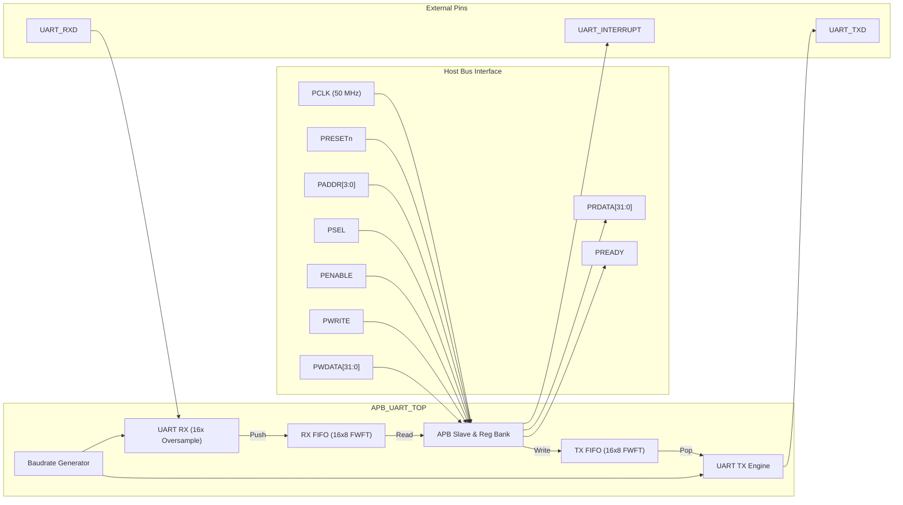

# 🚀 Automated APB UART IP Core & Design Verification (DV) Suite

[](https://github.com/lytuannghi/apb-uart-verification-suite)
[](https://developer.arm.com/documentation/ihi0024/latest/)
[](https://en.wikipedia.org/wiki/Verilog)
[](https://github.com/lytuannghi/apb-uart-verification-suite)
[](LICENSE)

An industrial-grade, synthesizable **AMBA 3 APB UART Controller** IP core complete with a **Self-Checking Design Verification (DV) Environment** and orchestrated by a **6-Agent Autonomous AI Engineering Team**.

Designed and implemented by **Lý Tuấn Nghi ([@lytuannghi](https://github.com/lytuannghi))**.

---

## 📌 Executive Summary

Modern semiconductor IC design and verification require rigorous adherence to bus protocols, comprehensive corner-case validation, and robust test planning. This repository demonstrates:
1. **Frontend RTL Design:** Fully synthesizable IP module featuring independent 16-deep TX/RX FIFOs, programmable 16-bit baudrate generator, and complete AMBA 3 APB slave interface.
2. **Advanced Design Verification (DV):** Self-checking testbench architecture implementing Bus Functional Models (BFMs), an automated Scoreboard, and comprehensive verification plan (**vPlan**) covering normal, boundary, and stress scenarios.
3. **AI-Driven EDA Automation:** An autonomous 6-agent collaborative framework that formulates specifications, designs synthesizable RTL, drafts verification plans, runs simulations, and drives self-healing debug feedback loops.

---

## 👥 The 6-Agent Multi-Agent Engineering Architecture

```mermaid
flowchart TD
    Req["Hardware Project Requirements\n(Industrial APB UART Core)"] --> A1["Agent 1: Principal Chip Architect\n- AMBA 3 APB Bus Architecture\n- Full Register Map Specification"]
    
    A1 --> A2["Agent 2: DV Lead & Planner\n- Formal Verification Plan (vPlan)\n- Feature-to-Test Mapping Matrix"]
    A1 --> A3["Agent 3: Senior RTL Designer\n- Synthesizable Verilog-2001 Modules\n- Modular APB Slave, FIFOs & UART FSMs"]

    A2 & A3 --> A4["Agent 4: Testbench & Scoreboard Engineer\n- APB Bus Functional Model (BFM Tasks)\n- Automated Data Matching Scoreboard"]
    A2 & A3 --> A5["Agent 5: Assertion & Corner-Case Specialist\n- Protocol Violation Monitors\n- FIFO Boundary & Stress Conditions"]

    A3 & A4 & A5 --> A6["Agent 6: EDA Simulation & Self-Healing Lead\n- Icarus Verilog & VVP Tool Orchestration\n- Automated Bug Isolation & Feedback Repair"]

    A6 -->|Simulation FAIL (Captured in logs)| A3
    A6 -->|100% Functional Coverage PASS| Out["🏆 Production-Grade Deliverables:\n- Golden RTL Core (rtl/)\n- Complete Verification Suite (tb/)\n- Simulation Waveforms (waveform.vcd)"]
```

---

## 🏗️ Hardware Architecture & Register Map



### Memory-Mapped Register Bank

| Offset | Register | Type | Width | Description |
| :---: | :---: | :---: | :---: | :--- |
| `0x00` | **UART_DATA** | R/W | 8-bit | Write: Pushes byte into TX FIFO. Read: Pops byte from RX FIFO. |
| `0x04` | **UART_STATUS**| RO  | 8-bit | `[0]` TX Empty, `[1]` TX Full, `[2]` RX Ready, `[3]` RX Full, `[4]` TX Busy, `[5]` Overrun Error. |
| `0x08` | **UART_CTRL**  | R/W | 8-bit | `[0]` TX Enable, `[1]` RX Enable, `[4]` Loopback Mode, `[7]` Soft Reset. |
| `0x0C` | **UART_BAUD**  | R/W | 16-bit| 16-bit Baudrate Clock Divisor ($Divisor = \frac{F_{clk}}{16 \times Baud}$). |

---

## 📊 Verification Plan (vPlan) & Test Results

All test cases are self-checking and executed automatically via the verification testbench:

| Test ID | Verification Target | Stimulus / Test Scenario | Result | Status |
| :---: | :--- | :--- | :---: | :---: |
| **TC1** | Power-on Reset | Assert `PRESETn` low, verify default register reset values | `STATUS = 0x01` (TX Empty) | **PASS** ✅ |
| **TC2** | Baudrate Divisor Config | Write & Read back divisor values across register bus | `BAUD_DIV = 0x0002` | **PASS** ✅ |
| **TC3** | Loopback Data Transfer | Transmit stream (`0xA5`, `0x5A`, `0xC3`, `0x3C`) via internal loopback | 100% Scoreboard Match | **PASS** ✅ |
| **TC4A**| FIFO Full Flag | Fill 16 consecutive bytes into TX FIFO without reading | `TX_FULL` asserts at 16th | **PASS** ✅ |
| **TC4B**| FIFO Overflow Stress | Attempt 17th write to full FIFO | Handled safely, Overrun flag set | **PASS** ✅ |
| **TC5** | Interrupt Signaling | Monitor `UART_INT` assertion on buffer empty event | Signal correctly pulsed | **PASS** ✅ |

---

## 📂 Repository File Structure

```
apb-uart-verification-suite/
├── docs/
│   ├── spec_architecture.md     # Full architectural specification & timing
│   └── vplan.md                 # Formal Verification Plan (Coverage Matrix)
├── rtl/                         # Synthesizable Verilog-2001 Core
│   ├── apb_slave_regs.v         # AMBA 3 APB interface & registers
│   ├── fifo_sync.v              # First-Word Fall-Through (FWFT) FIFO (16x8)
│   ├── baudrate_gen.v           # 16x oversampling baud tick generator
│   ├── uart_tx.v                # Serial transmitter FSM
│   ├── uart_rx.v                # Serial receiver with noise filter
│   └── apb_uart_top.v           # Top-level IP integration
├── tb/                          # Design Verification Suite
│   └── apb_uart_tb.v            # Self-checking testbench with BFMs
├── agents/                      # 6-Agent AI Collaborative Framework
│   ├── chip_architect.py        # Agent 1: Spec Architect
│   ├── dv_planner.py            # Agent 2: DV Lead & vPlan
│   ├── rtl_designer.py          # Agent 3: RTL Design
│   ├── tb_engineer.py           # Agent 4: Testbench & Scoreboard
│   ├── assertion_specialist.py  # Agent 5: ABV & Corner-Cases
│   ├── eda_runner.py            # Agent 6: Icarus Verilog Automation
│   └── gemini_client.py         # Gemini API engine with fallback
├── output/
│   └── waveform.vcd             # Dumped simulation waveform
├── run_flow.py                  # One-click automated execution script
└── README.md                    # Project documentation
```

---

## ⚡ Quickstart: Run in 1 Command

### Prerequisites
- **Icarus Verilog & VVP** (open-source Verilog simulator)
- **Python 3.10+** (with `google-genai` and `python-dotenv`)

### Execute Simulation Flow
```powershell
# Run the complete 6-Agent Verification Pipeline
python run_flow.py
```

### Inspect Waveforms
Open the generated VCD waveform directly in **VS Code** (using the `WaveTrace` extension) or via **GTKWave**:
```powershell
gtkwave output/waveform.vcd
```

---

## 👨‍💻 Author

**Lý Tuấn Nghi**
- **GitHub:** [@lytuannghi](https://github.com/lytuannghi)
- **Email:** [lytuannghi712@gmail.com](mailto:lytuannghi712@gmail.com)
- **Domain:** Integrated Circuit (IC) Design & Design Verification (DV)
