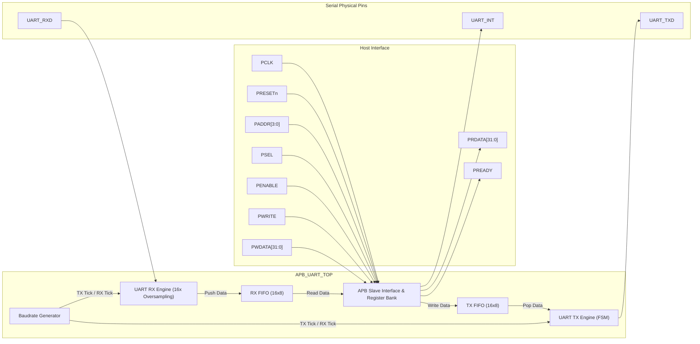

# APB UART Controller IP - Architectural Specification

## 1. Overview
The **APB UART Controller** is a high-performance, synthesizable digital peripheral designed to bridge a system host processor via the **AMBA 3 APB (Advanced Peripheral Bus)** protocol to a standard asynchronous serial communication link (UART).

---

## 2. Key Features
- **Bus Interface:** Fully compliant with AMBA 3 APB specification.
- **Data Buffering:** Independent 16-deep Synchronous FIFOs for both Transmit (TX) and Receive (RX) paths.
- **Baud Rate Generator:** Programmable 16-bit divisor supporting standard baud rates (9600, 19200, 115200 bps at 50MHz/100MHz system clocks).
- **UART Frame Format:** 
  - 1 Start bit
  - 8 Data bits
  - Optional Parity (Even, Odd, or None)
  - 1 Stop bit
- **Status & Interrupts:**
  - TX FIFO Empty / TX FIFO Full
  - RX FIFO Data Ready / RX FIFO Full / RX Overrun
  - Global Interrupt output asserting on RX Ready or TX Complete

---

## 3. Register Map (Memory Mapped via APB)

The module occupies an 8-bit address space mapped to 32-bit registers (aligned to 4-byte boundaries):

| Offset | Register Name | Access | Width | Description |
| :---: | :---: | :---: | :---: | :--- |
| `0x00` | **UART_DATA** | R/W | 8-bit | Write: Pushes byte into TX FIFO. Read: Pops byte from RX FIFO. |
| `0x04` | **UART_STATUS**| R | 8-bit | Status Flags: `[0]` TX Empty, `[1]` TX Full, `[2]` RX Ready, `[3]` RX Full, `[4]` TX Busy, `[5]` Overrun Error. |
| `0x08` | **UART_CTRL**  | R/W | 8-bit | Control: `[0]` TX Enable, `[1]` RX Enable, `[2]` Parity Enable, `[3]` Parity Odd/Even, `[4]` Loopback Mode, `[7]` Soft Reset. |
| `0x0C` | **UART_BAUD**  | R/W | 16-bit| 16-bit Baudrate Clock Divisor ($Divisor = \frac{F_{clk}}{16 \times Baud}$). |

---

## 4. Hardware Architecture Block Diagram

